# Élan Boutique

**Women's fashion e-commerce with per-variant inventory, order management, and a full admin panel.**

**Live storefront:** [https://elan-boutique.pages.dev](https://elan-boutique.pages.dev)

---

## The problem

A small fashion boutique was selling through social media DMs — no inventory tracking, no order history, no way to know what was actually in stock. Variants (size × color) were tracked mentally, orders were lost in chat threads, and the owner had no dashboard. 

The business needed a real storefront with real inventory, without hiring a dedicated developer or paying for heavy e-commerce platforms.

## The solution

### Storefront
- Hierarchical categories (parent → child) for browsing.

- Product pages with multi-image galleries and per-variant stock.

- Persistent cart and checkout flow with customer details.

- Order confirmation with WhatsApp and email notifications.

- Fully responsive, Tailwind-styled UI.

### Admin panel
- Token-authenticated dashboard with sales overview and low-stock alerts.

- Full CRUD on products, variants, categories, and images.

- Order management with status transitions and customer communication.

- Settings for store metadata, contact channels, and notification routing.

---

## Tech stack

- **Frontend:** HTML + Tailwind CSS.

- **Backend & Data:** Google Apps Script as the application layer, Google Sheets as the operational database.

- **Media:** Supabase Storage for product images.

- **Hosting:** Cloudflare Pages.

- **Notifications:** WhatsApp deep links + Email.

---

## Architecture

1. The browser loads the frontend from **Cloudflare Pages**.

2. The frontend fetches data from a **Google Apps Script** web app.

3. The script reads and writes to **Google Sheets** (database) and **Supabase Storage** (images).

4. Read requests are heavily cached via **CacheService** to improve performance and stay within platform quotas.

---

## Notable engineering decisions

- **Lock-based order creation.** Concurrent checkout writes are serialized through `LockService`, preventing race conditions that would double-decrement variant stock. Every order captures an immutable snapshot of line items at time of purchase.

- **Cache-size safeguards.** Apps Script's `CacheService` has hard size limits; products are chunked and headers stripped before caching, with automatic fallback to a direct read. A `localStorage` mirror absorbs the remaining reads.

- **Token auth with rate limiting.** Admin sessions use rotating tokens with per-IP throttling, preventing brute-force access to the CRUD endpoints.

- **XSS-safe rendering.** All customer-supplied strings (names, addresses, notes) are escaped at the boundary before being rendered into admin views and notifications.

- **Per-variant inventory.** Stock is modeled at the size × color level, not the product level — the unit the business actually tracks. Adjustments on order creation are done under the same lock as the order write.

- **Sheets as a database, deliberately.** The operator already lived in Google Sheets. Modeling the schema around their mental model meant the admin panel and the underlying data stayed legible — with the tradeoffs (locking, caching, size limits) handled explicitly.

---

## Screenshots

> Redaction note: customer names, emails, phone numbers, and order IDs are obscured in published screenshots.

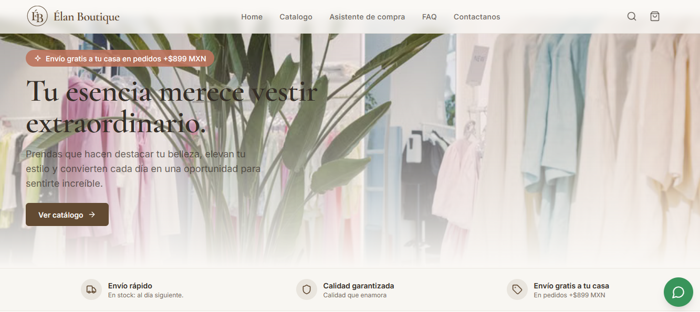
*Caption: Storefront home — featured collections and category navigation.*

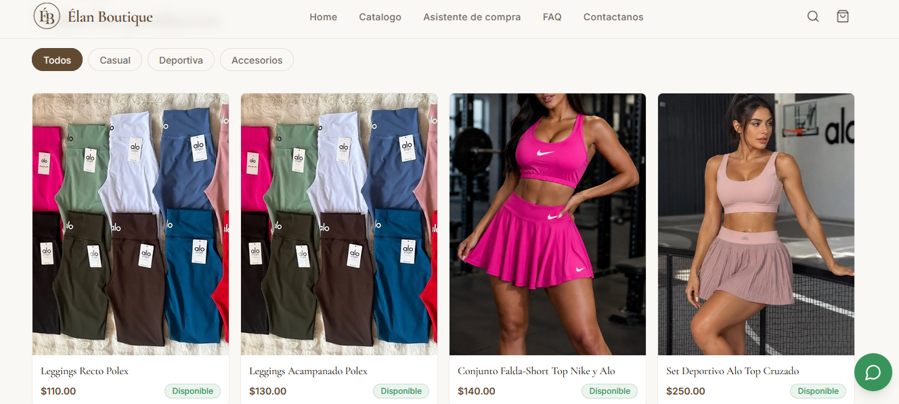
*Caption: Category listing with variant-aware product cards.*

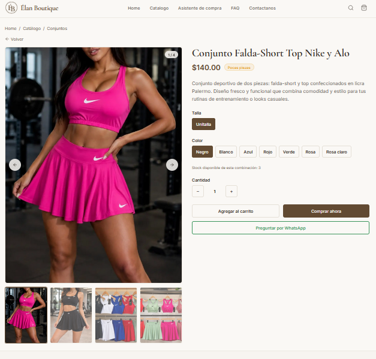

*Caption: Product detail with multi-image gallery and per-variant stock.*

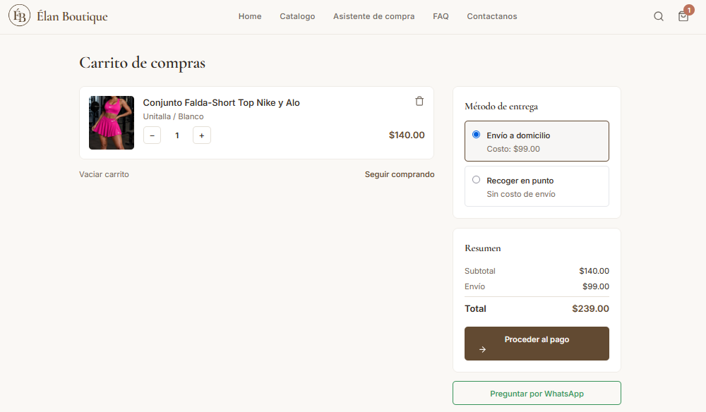
*Caption: Cart with variant summary and quantity controls.*

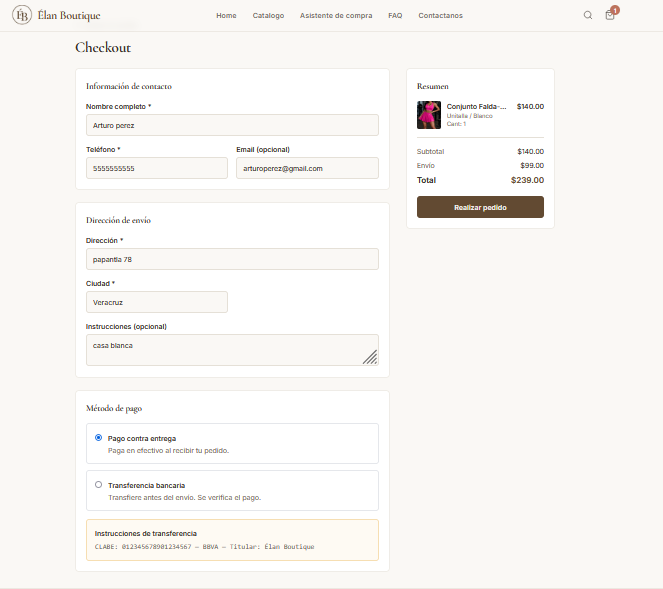

*Caption: Checkout — customer details and delivery information.*

*Caption: Order confirmation with WhatsApp follow-up link.*

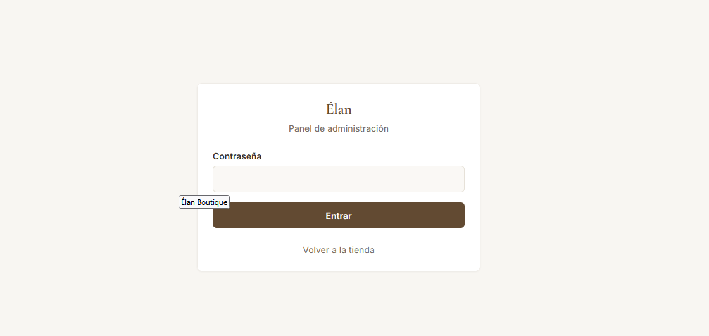
*Caption: Admin login (screenshot only — not publicly accessible).*

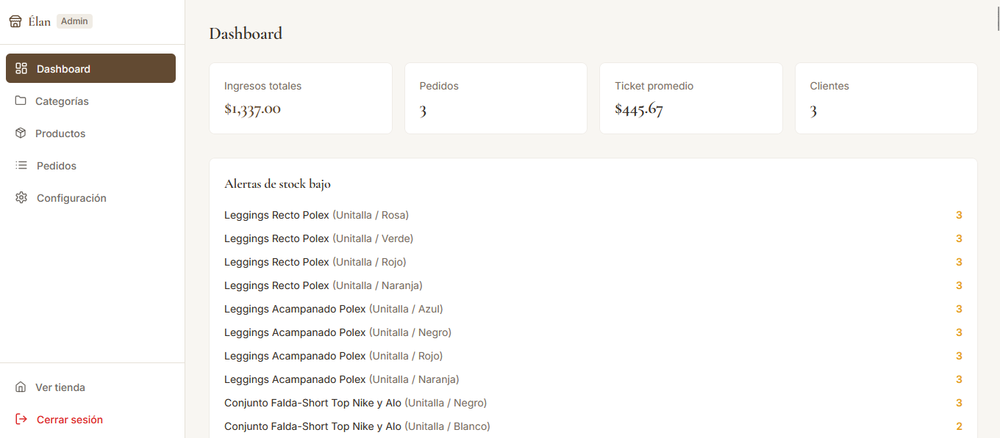
*Caption: Admin dashboard — recent orders and low-stock alerts.*

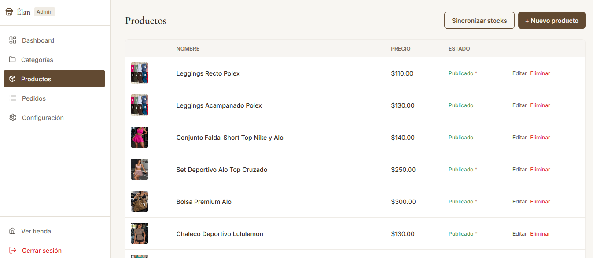
*Caption: Product list with variant counts and stock status.*

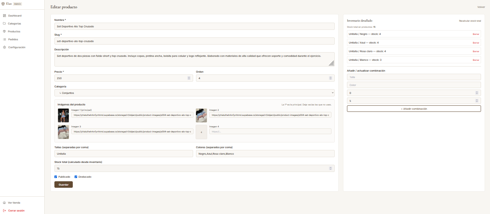
*Caption: Product editor — variants, images, and category assignment.*

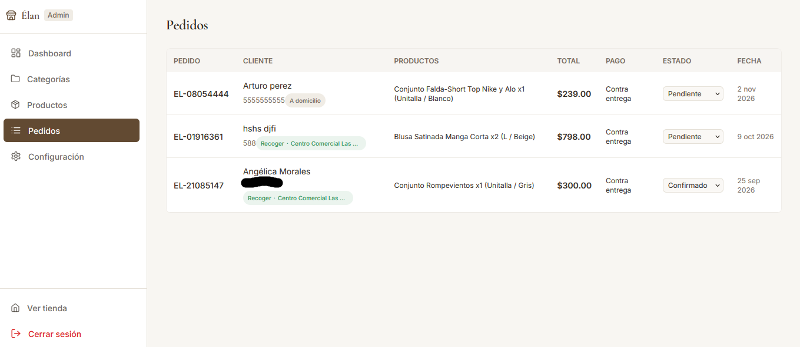
*Caption: Order management with status transitions.*

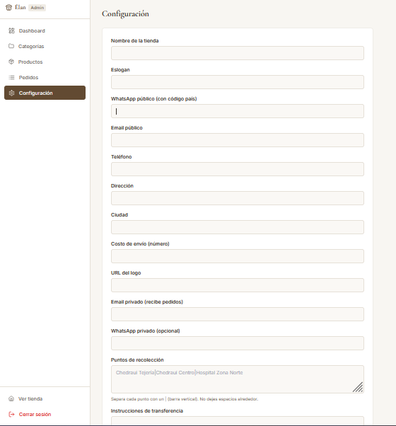
*Caption: Store settings — notifications, contact channels, and metadata.*

---

## Status

**Live in production**, used by a real business. Ongoing maintenance as the catalog and order volume grow.

### Roadmap / known limitations
- Shipping/tax rules are intentionally simple and managed manually by the operator.

- Analytics are aggregate-only; a per-customer view is out of scope for a boutique of this size.

- Migrating the datastore off Sheets is a future option if volume exceeds what the caching layer comfortably absorbs.

---

*Source code is private. This folder is a showcase only.*
