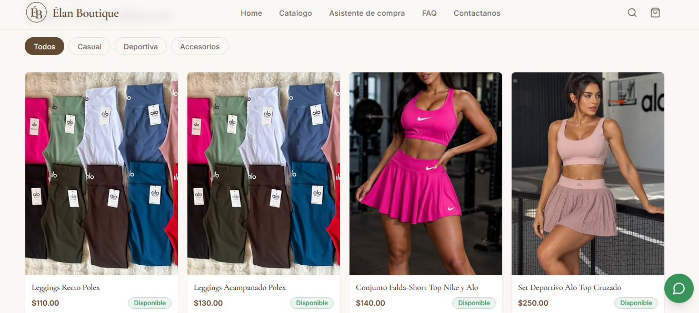
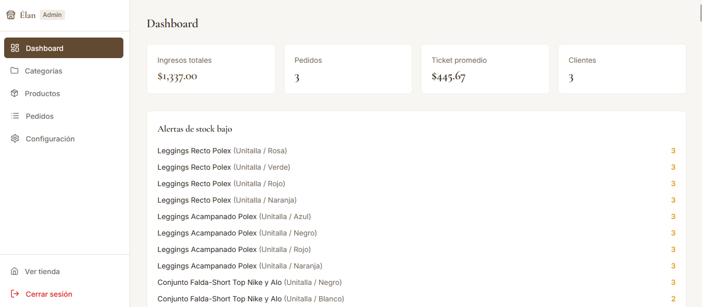

<div align="center">

# Élan Boutique

### A small fashion boutique, out of the DMs and into a real operating system.

Per-variant inventory · order lifecycle · admin console · business intelligence — built for a real business, running in production.

[](#status)
[](#)
[](#the-problem)
[](#)

**[🛍️ Live storefront](https://elan-boutique.pages.dev)** · **[📸 Screenshots](#screenshots)** · **[🧠 Engineering deep-dive →](./FOR-RECRUITERS.md)** · **[✉️ Get in touch](#work-with-me)**

</div>

---

## The problem

A small women's fashion boutique sold through **social media DMs**. Variants (size × color) were tracked from memory, orders were lost in chat threads, and the owner had **no inventory of what was actually in stock** and **no history of what sold**.

The business needed a real storefront with real inventory — **without** paying for a heavyweight e-commerce platform.

## What I built

A production storefront and an admin console that replaced the DM workflow end-to-end: browsing, per-variant stock, cart, checkout, order confirmation, customer follow-up, and an operator dashboard the owner opens every morning.

<div align="center">

| Before | After |
|---|---|
| Stock tracked from memory | Per-variant inventory (size × color) reconciled on every order |
| Orders lost in DMs | Order lifecycle with status, history, and immutable line-item snapshots |
| "Did I sell this?" | Dashboard: revenue, ticket average, top of low-stock alerts |
| Manual WhatsApp follow-up | Automated confirmation link + email to the owner on every order |
| No record of customers | Customer list, order history, repeat-purchase visible |

</div>

---

## Problems solved — at a glance

> The same system viewed three ways: what broke, what it saves, and what it now tells the owner.

### 🧱 Operational problems solved

- **Race conditions on stock.** Two customers checking out the same last unit would double-decrement it. Every order write is serialized through a lock and reconciles variant stock inside the same transaction.
- **Lost orders.** Orders were chat threads; there was no canonical record. Every order now persists a customer snapshot, an immutable line-item snapshot, and a lifecycle state.
- **Variant blindness.** "Do we have this in M / black?" was unanswerable. Stock is modeled at size × color, the unit the business actually tracks, and surfaced on the product page.
- **Silent failures.** A dropped email or a failed write could go unnoticed. Order confirmation is idempotent and surfaced in the admin; low-stock alerts are proactive.
- **Admin access.** A public admin route with no auth is a liability. Admin sessions use rotating server-issued tokens with brute-force throttling; the panel is not publicly reachable.

### ⏱️ Time saved (operator)

- **Order intake:** from ~10 min of back-and-forth per order to ~2 min (customer fills checkout, owner gets a structured notification).
- **Stock checks:** from "let me look at the shelf / ask" to **seconds** in the admin product editor.
- **Daily overview:** from none to a **single dashboard** with revenue, orders, average ticket, customer count, and low-stock alerts.
- **Manual follow-up:** from a manual WhatsApp copy-paste to a **one-tap confirmation link** pre-filled with the full order.

### 🎯 Accuracy & reliability

- **Stock is the source of truth.** `products.stock` is *derived* from `inventory` and recalculated on every variant mutation — no drift between the summary and the detail.
- **Immutable order history.** Line items are snapshotted at purchase time; later price or name changes don't rewrite history.
- **Deterministic totals.** Delivery fee and totals are computed server-side; the client never decides what an order costs.
- **Safe rendering.** Every customer-supplied string is escaped at the boundary before it reaches admin views, notifications, or the storefront.

### 📊 Business intelligence (what the owner now knows)

- **Revenue, order count, average ticket, customer count** — live, on the admin dashboard.
- **Low-stock alerts** derived from per-variant thresholds — the operator sees what needs restocking before it sells out, not after.
- **Delivery vs. pickup** split, and per-pickup-point demand, visible in the orders table.
- **Repeat-customer visibility** via the customers table (phone-keyed).
- **Operational clarity on demand** — the schema mirrors the operator's mental model, so the data is legible without a BI tool.

---

## Live product

**[elan-boutique.pages.dev](https://elan-boutique.pages.dev)** — the real storefront. It proxies a Google Apps Script web app behind a clean domain (the Apps Script `/exec` URL is intentionally not the public entry point).

> The admin panel is **not publicly reachable**. Screenshots below; access is scoped to the operator.

---

## Screenshots

<div align="center">

### Storefront

| | |
|---|---|
|  <br/> **Home** — featured collections, category navigation |  <br/> **Category** — variant-aware product cards |
|  <br/> **Product** — multi-image gallery, per-variant stock |  <br/> **Cart** — variant summary, quantity controls |
|  <br/> **Checkout** — customer details, delivery method |  <br/> **Confirmation** — WhatsApp follow-up link |

### Admin console

| | |
|---|---|
|  <br/> **Login** — token-issued session |  <br/> **Dashboard** — revenue, orders, low-stock alerts |
|  <br/> **Products** — variant counts, publish state |  <br/> **Editor** — variants, 4-image gallery, category |
|  <br/> **Orders** — status transitions, delivery badges |  <br/> **Settings** — contact, delivery, notifications |

</div>

*Customer names, emails, phone numbers, and order IDs are obscured in published screenshots.*


---

## Architecture

```text
┌──────────────────────┐        ┌───────────────────────────┐
│  Cloudflare Pages    │  HTTPS │  Google Apps Script        │
│  (redirect / domain) │ ─────▶ │  web app  (API + SPA)      │
└──────────────────────┘        └──────────────┬────────────┘
                                               │
                    ┌──────────────────────────┼──────────────────────────┐
                    ▼                          ▼                          ▼
          ┌──────────────────┐      ┌──────────────────┐      ┌──────────────────┐
          │  Google Sheets   │      │  CacheService    │      │  Supabase        │
          │  (operational DB)│      │  (read layer)    │      │  Storage (media) │
          └──────────────────┘      └──────────────────┘      └──────────────────┘
                                               │
                                               ▼
                                   ┌──────────────────────┐
                                   │  WhatsApp + Email    │
                                   │  (owner notify)      │
                                   └──────────────────────┘