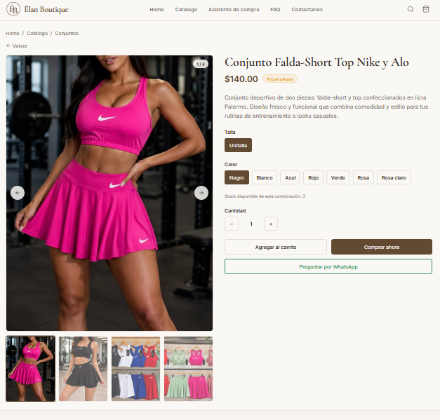
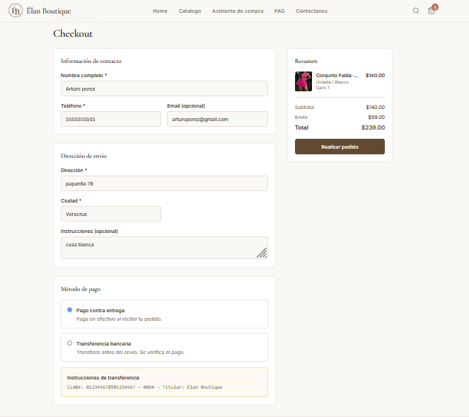
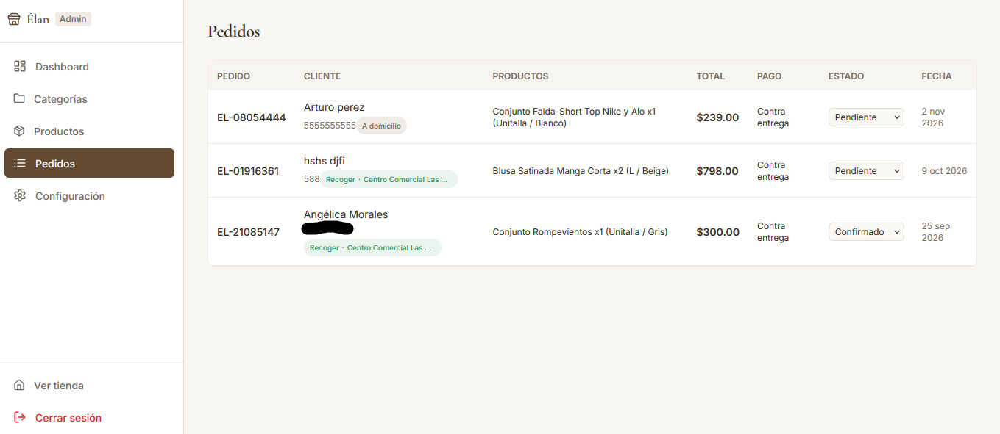
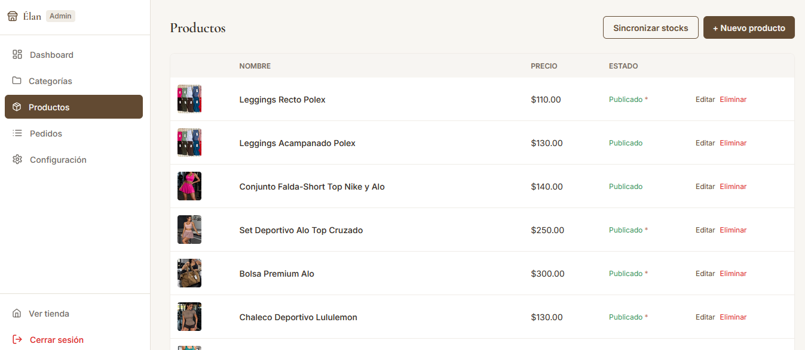
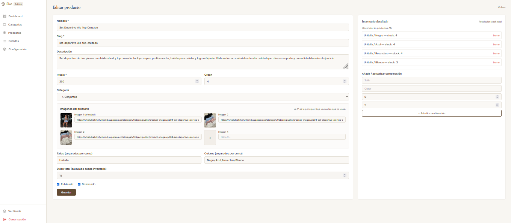

# Élan Boutique

### Replacing manual social-media sales with a complete, automated e-commerce system.

Per-variant inventory · order lifecycle · secure admin console · business intelligence — built for a real business, running in production.

**[Live storefront](https://elan-boutique.pages.dev)** · **[Screenshots](#screenshots)** · **[Engineering deep-dive](./FOR-RECRUITERS.md)** · **[Get in touch](#work-with-me)**

---

## The Problem

A small women's fashion boutique was selling through **social media DMs**. Variants (size and color) were tracked from memory, orders were lost in chat threads, and the owner had **no visibility into what was actually in stock** and **no history of what sold**.

The business needed a real storefront with real inventory.

## What I Built

A production storefront and an admin console that replaced the DM workflow end-to-end. Customers can now browse, check out, and receive order confirmations. The owner uses a private dashboard to manage inventory and track sales.

| Before (The DM Chaos) | After (The Automated System) |
|---|---|
| Stock tracked from memory | Per-variant inventory (size × color) updated on every order |
| Orders lost in chat threads | Order lifecycle with status, history, and snapshotted line items |
| No sales data | Live Dashboard: revenue, ticket average, and low-stock alerts |
| Manual WhatsApp follow-up | Automated confirmation link and email notification |
| No customer database | Customer list with order history and repeat-purchase visibility |

---

## Engineering Methodology

To make this system reliable for a real business, I had to solve several technical challenges.

**1. Concurrency (Preventing Double-Sells)**
*   **The Challenge:** Two customers checking out the last unit of a variant at the exact same time could double-decrement the stock.
*   **The Solution:** Every order write is serialized through a server-side lock (`LockService`) and reconciles variant stock inside the same transaction, guaranteeing inventory accuracy.

**2. Performance (Speed and Quotas)**
*   **The Challenge:** Reading directly from the database on every page load is slow and hits platform limits.
*   **The Solution:** I built a three-layer caching strategy (`CacheService`, per-request memory, and `localStorage`). The storefront loads quickly, and database reads are significantly reduced.

**3. Security (Auth and XSS)**
*   **The Challenge:** Protecting the admin panel and customer data.
*   **The Solution:** The system uses rotating server-issued tokens with a 12-hour expiration and brute-force throttling. All customer-supplied strings are escaped at the boundary to prevent XSS injection in admin views and automated emails.

**4. Clean Data Architecture**
*   **The Challenge:** Handling products with multiple sizes and colors without losing track of core stock.
*   **The Solution:** Stock is modeled at the variant level. The main product's stock is automatically derived and recalculated. Orders capture an immutable snapshot, so changing a product price later does not affect past receipts.

---

## Business Intelligence

The system does more than process orders; it provides the owner with actionable data:
*   **Live Metrics:** Revenue, order count, average ticket, and customer count.
*   **Proactive Restocking:** Low-stock alerts based on per-variant thresholds.
*   **Demand Analysis:** Delivery versus pickup split, and per-pickup-point demand.

---

## Architecture and Tech Stack

The application is built with a highly optimized, lightweight architecture:

*   **Frontend:** Cloudflare Pages hosting a modern, responsive Single Page Application (SPA) built with HTML5 and Tailwind CSS.
*   **Backend:** Google Apps Script acting as a serverless API.
*   **Database:** Google Sheets (chosen deliberately because the operator was already familiar with it).
*   **Storage:** Supabase for fast image hosting.
*   **Notifications:** Automated WhatsApp deep links and Emails directly to the owner.

---

## Screenshots

### Storefront
| | |
|---|---|
|    **Home** — featured collections |    **Category** — variant-aware cards |
|    **Product** — multi-image gallery |    **Checkout** — seamless order flow |

### Admin Console
| | |
|---|---|
|    **Dashboard** — revenue and stock alerts |    **Orders** — status transitions |
|    **Products** — manage catalog |    **Editor** — variant management |

*Customer names, emails, phone numbers, and order IDs are obscured in published screenshots for privacy.*

---

## Work With Me

I built Élan Boutique as a real production system for a real business. The admin panel is **not publicly reachable**; access is scoped to the operator.

I am currently open to:
*   **Junior Developer Roles:** I am eager to bring this problem-solving mindset to a full-time engineering team.
*   **Collaborations:** Partnering on lean, operator-first software.
*   **Freelance and Contract Work:** Building custom e-commerce and internal tools.

*Note: The source code is private as it is actively used in production. I am happy to do a live code walkthrough during an interview.*

**Reach me:** [Email] · [LinkedIn] · [https://github.com/razielrosasm-cmd]

---

Source code is private. This repository is a showcase of my production work.

