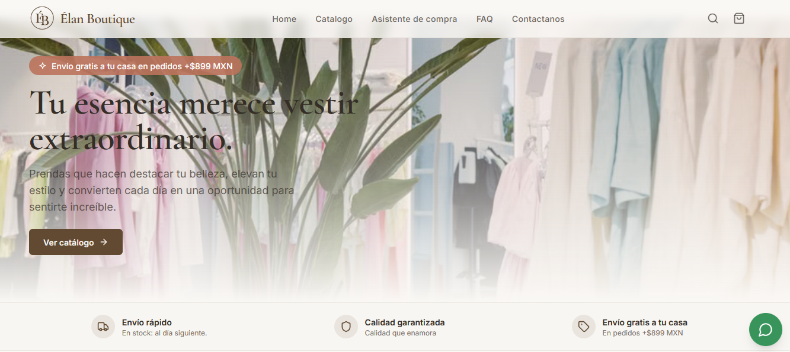
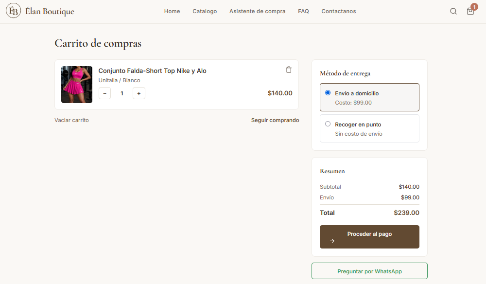
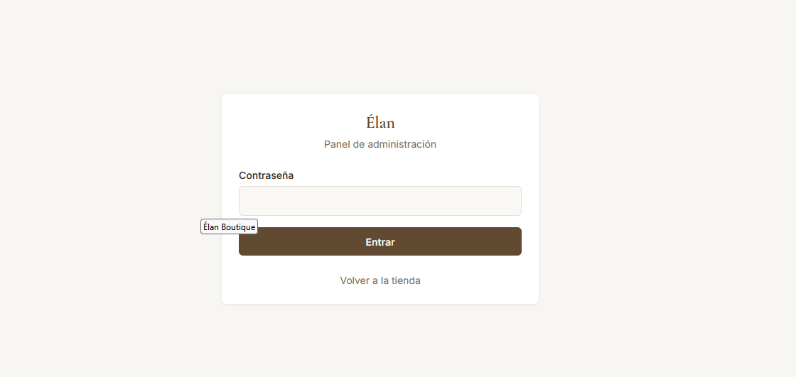
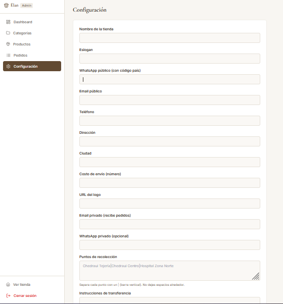

# Élan Boutique

::: {align="center"}
### From social media sales to a complete boutique e-commerce operating system.

A production-ready e-commerce solution designed for fashion boutiques
that want to move beyond manual orders, scattered inventory records, and
social media DMs.

**Online storefront · Variant-level inventory · Order management · Admin
dashboard · Business intelligence**

[](#live-product)
[](#)
[](#what-i-built)
[](#)

**[🛍️ Live Storefront](https://elan-boutique.pages.dev)** · **[📸
Screenshots](#screenshots)** · **[🧠 Engineering Deep-Dive
→](./FOR-RECRUITERS.md)** · **[✉️ Discuss Your Boutique
Solution](#work-with-me)**
:::

------------------------------------------------------------------------

## The problem

Many small fashion boutiques manage their businesses through social
media messages, spreadsheets, and manual inventory tracking.

While this approach may work initially, it becomes increasingly
difficult to manage as the business grows.

Products come in multiple sizes and colors, stock availability changes
constantly, and orders become scattered across conversations.

The result?

-   **Inventory uncertainty:** Owners cannot reliably determine which
    sizes and colors are available.
-   **Lost orders:** Customer requests and order details get buried in
    social media conversations.
-   **Manual operations:** Order processing, stock updates, and customer
    follow-ups consume valuable time.
-   **Limited visibility:** There is no centralized record of sales,
    customers, or business performance.
-   **Growth limitations:** Managing more products and customers
    increases operational complexity.

The business needed more than an online catalog. It needed a centralized
system to manage its day-to-day operations.

## What I built

I developed a complete e-commerce platform and administrative management
system that transforms the traditional boutique sales workflow into a
centralized digital operation.

The solution connects the customer shopping experience with the internal
business processes required to manage products, inventory, orders,
customers, and sales performance.

**The platform covers the complete sales lifecycle:**

-   **Online storefront:** Product catalog, categories, product
    galleries, and product availability.
-   **Variant-level inventory:** Independent stock management for each
    size and color combination.
-   **Shopping cart and checkout:** Structured customer information,
    order details, and delivery selection.
-   **Order management:** Centralized order records, status tracking,
    and historical information.
-   **Customer management:** Customer records and purchase history.
-   **Administrative console:** A centralized interface for managing
    products, inventory, orders, and business settings.
-   **Business intelligence:** A dashboard providing visibility into
    revenue, orders, average ticket, customers, and inventory alerts.
-   **Customer communication:** Automated order notifications and
    WhatsApp-based confirmation workflows.

The result is a complete operating system for a boutique, rather than
simply a website where customers can browse products.

::: {align="center"}
  -----------------------------------------------------------------------
  Before                              After
  ----------------------------------- -----------------------------------
  Stock tracked manually or from      Inventory managed by product
  memory                              variant (size × color)

  Orders scattered across social      Centralized order management and
  media DMs                           status tracking

  Uncertainty about available         Inventory visibility through the
  products                            platform

  Manual order confirmation and       Structured order notifications and
  follow-up                           WhatsApp confirmation

  No centralized customer records     Customer database and purchase
                                      history

  Limited visibility into sales       Administrative dashboard with
  performance                         business metrics
  -----------------------------------------------------------------------
:::

------------------------------------------------------------------------

## Problems solved --- at a glance

> The same solution delivers value from three perspectives: operational
> efficiency, data reliability, and business intelligence.

### 🧱 Operational problems solved

-   **Inventory race conditions.** Two customers attempting to purchase
    the last available unit could cause inconsistent stock levels. Order
    writes are serialized through a lock, with variant inventory
    reconciled within the same transaction.
-   **Lost or fragmented orders.** Every order now has a centralized
    record containing customer information, immutable line-item
    snapshots, and a defined lifecycle state.
-   **Variant-level inventory visibility.** Stock is managed
    independently for each size and color combination, allowing
    customers and administrators to see actual product availability.
-   **Unreliable order processing.** Order confirmation is designed to
    be idempotent, while notification and low-stock workflows provide
    additional operational visibility.
-   **Administrative access security.** The administrative interface is
    protected through server-issued rotating session tokens and
    brute-force throttling rather than relying on an unrestricted public
    admin route.

### ⏱️ Operational efficiency --- time saved

-   **Order intake:** Reduced from approximately 10 minutes of manual
    back-and-forth to approximately 2 minutes through structured
    customer checkout and automated owner notifications.
-   **Inventory checks:** Replaced manual shelf inspections and informal
    inquiries with centralized stock visibility in the administrative
    product editor.
-   **Daily business overview:** Replaced the absence of centralized
    reporting with a dashboard displaying revenue, order count, average
    ticket, customer count, and low-stock alerts.
-   **Customer follow-up:** Replaced manual WhatsApp copy-and-paste
    workflows with a one-tap confirmation link containing the order
    information.

*Time savings are based on the estimated operating workflow and should
be treated as illustrative rather than independently measured
performance results.*

### 🎯 Accuracy & reliability

-   **Inventory as the source of truth.** `products.stock` is derived
    from `inventory` and recalculated after variant mutations,
    maintaining consistency between product-level summaries and
    variant-level stock.
-   **Immutable order history.** Product names, prices, and quantities
    are snapshotted when an order is created. Subsequent catalog changes
    do not rewrite historical order details.
-   **Server-side calculations.** Delivery fees and order totals are
    calculated on the server, preventing the client from independently
    determining the final order amount.
-   **Safe data rendering.** Customer-supplied strings are escaped at
    the appropriate boundaries before being displayed in administrative
    views, notifications, and the storefront.
-   **Consistent order processing.** Transactional inventory updates and
    idempotent confirmation workflows help prevent duplicate processing
    and inconsistent business records.

### 📊 Business intelligence --- turning operations into decisions

The platform gives the owner access to operational information that was
previously unavailable or scattered across different channels.

-   **Sales performance:** Revenue, order count, and average ticket.
-   **Customer visibility:** Customer records, purchase history, and
    repeat-customer identification.
-   **Inventory intelligence:** Low-stock alerts based on individual
    variant thresholds.
-   **Delivery insights:** Delivery versus pickup distribution and
    demand by pickup location.
-   **Product visibility:** Product and variant availability, helping
    identify restocking requirements.
-   **Operational reporting:** Centralized business information through
    a dashboard without requiring a separate BI platform.

The objective is not simply to collect business data, but to make it
accessible and useful for everyday decisions.

------------------------------------------------------------------------

## Live product

**[elan-boutique.pages.dev](https://elan-boutique.pages.dev)** --- the
live storefront and reference implementation of the solution.

This is a working implementation built for a real fashion boutique,
demonstrating how the platform operates in a production environment.

The storefront uses Cloudflare Pages as its public entry point and
proxies a Google Apps Script web application behind a clean domain. The
underlying Apps Script `/exec` URL is intentionally not exposed as the
public entry point.

**The administrative console is restricted to authorized operators** and
is not publicly accessible.

The screenshots below demonstrate both the customer-facing shopping
experience and the internal management capabilities.

------------------------------------------------------------------------

## Screenshots

::: {align="center"}
### Storefront

  ---------------------------------------------- -------------------------------------------------------
       
  `<br/>`{=html} **Home** --- Featured           `<br/>`{=html} **Category** --- Product catalog with
  collections and category navigation            variant-aware availability

      `<br/>`{=html} **Cart**
  `<br/>`{=html} **Product** --- Multi-image     --- Variant summary and quantity controls
  gallery and per-variant stock                  

          
  `<br/>`{=html} **Checkout** --- Customer       `<br/>`{=html} **Confirmation** --- Order confirmation
  information and delivery selection             and WhatsApp follow-up
  ---------------------------------------------- -------------------------------------------------------

### Admin console

  ----------------------------------------------- ---------------------------------------------------
           
  `<br/>`{=html} **Login** --- Authenticated      `<br/>`{=html} **Dashboard** --- Revenue, orders,
  administrative session                          and low-stock alerts

     
  `<br/>`{=html} **Products** --- Product         `<br/>`{=html} **Editor** --- Variant management,
  management, variant counts, and publishing      four-image gallery, and categories
  status                                          

         
  `<br/>`{=html} **Orders** --- Order status      `<br/>`{=html} **Settings** --- Business contact,
  management and delivery information             delivery, and notification configuration
  ----------------------------------------------- ---------------------------------------------------
:::

*Customer names, email addresses, phone numbers, and order IDs are
obscured in published screenshots to protect customer privacy.*

------------------------------------------------------------------------

## Architecture

The solution uses a lightweight architecture that connects the public
storefront, application logic, operational database, caching layer,
media storage, and customer communication workflows.

``` text
┌──────────────────────┐       ┌───────────────────────────┐
│  Cloudflare Pages    │ HTTPS │  Google Apps Script       │
│  (redirect / domain) │ ─────▶│  web app (API + SPA)      │
└──────────────────────┘       └──────────────┬────────────┘
                                              │
                    ┌─────────────────────────┼─────────────────────────┐
                    ▼                         ▼                         ▼
          ┌──────────────────┐      ┌──────────────────┐      ┌──────────────────┐
          │  Google Sheets   │      │  CacheService    │      │  Supabase        │
          │  (operational DB)│      │  (read layer)    │      │  Storage (media) │
          └──────────────────┘      └──────────────────┘      └──────────────────┘
                                              │
                                              ▼
                                   ┌──────────────────────┐
                                   │  WhatsApp + Email    │
                                   │  (owner notification)│
                                   └──────────────────────┘
```

------------------------------------------------------------------------

## Work with me

### Give your boutique its own digital operating system.

Élan Boutique is a reference implementation of a reusable e-commerce
solution designed for small and growing fashion businesses.

I can adapt the platform to your boutique's identity, products,
inventory structure, and operational requirements.

**What your boutique can get:**

-   A branded online storefront.
-   Product and variant inventory management.
-   Shopping cart and customer checkout.
-   Centralized order and customer management.
-   Administrative dashboard and sales reporting.
-   WhatsApp and email communication workflows.
-   Business-specific configuration and deployment.

### Built around your business, not a generic template.

Every boutique has different products, workflows, delivery requirements,
and business needs. The solution can be configured and extended to
accommodate those differences.

**Interested in bringing your boutique online?**

Let's discuss your business requirements and how this solution can be
adapted to your operation.
