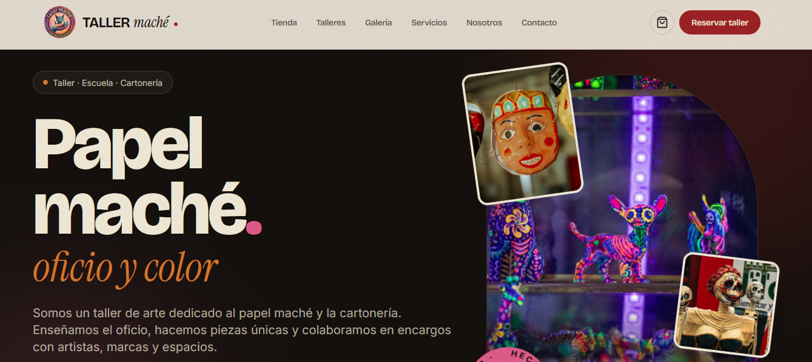
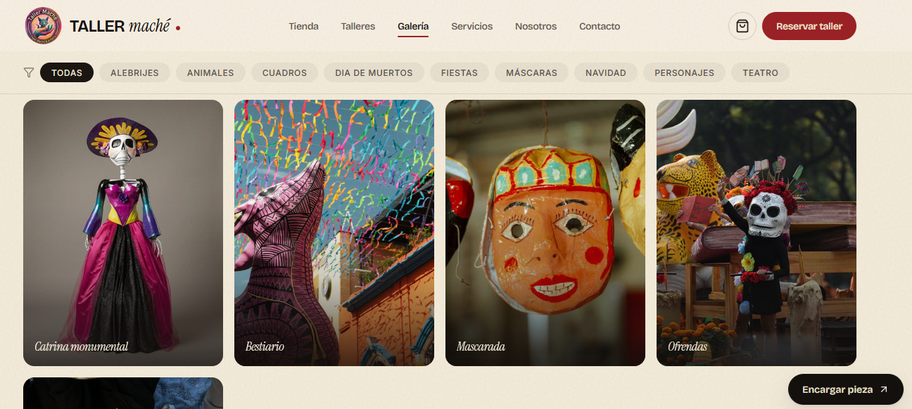
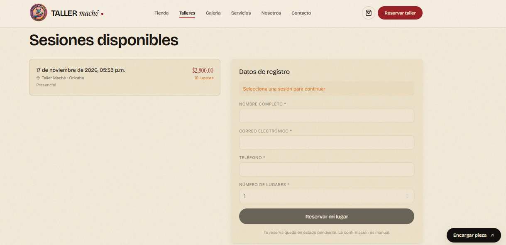
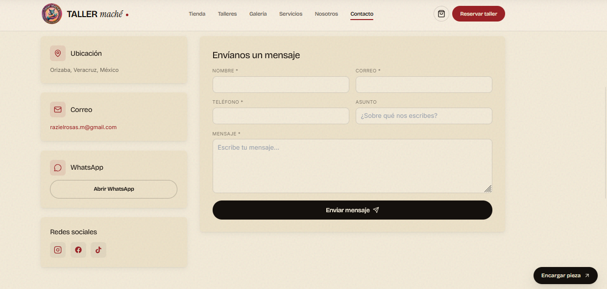
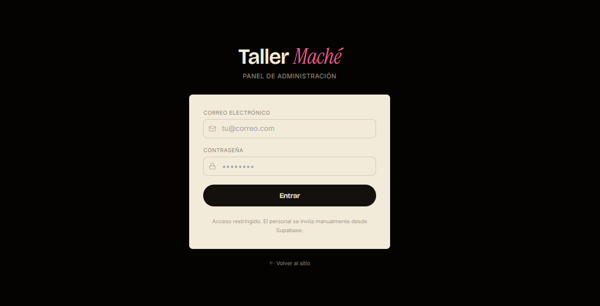
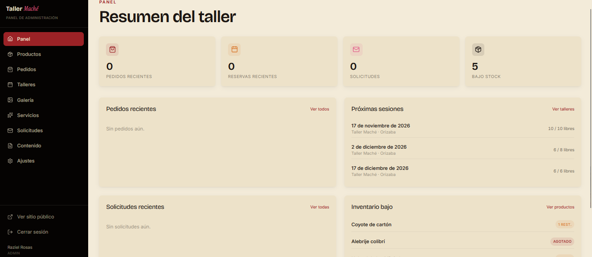
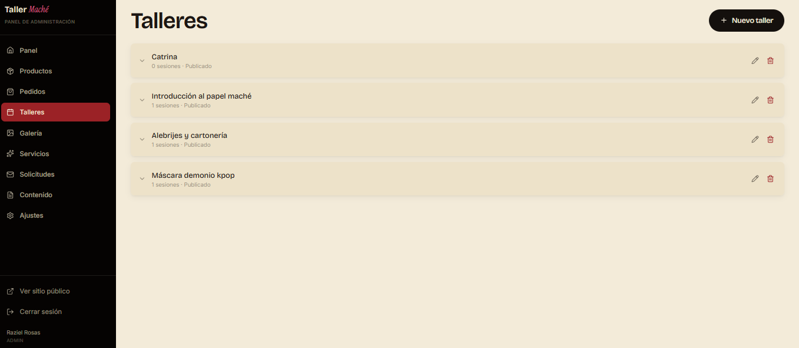
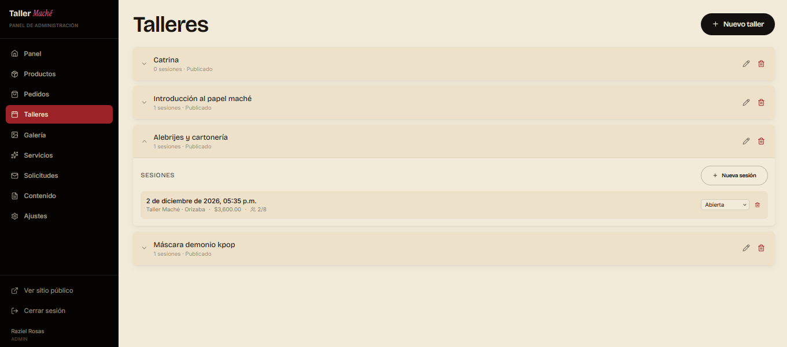
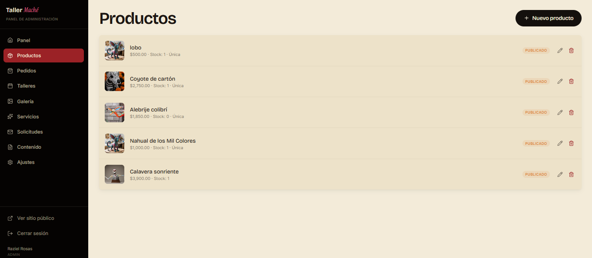
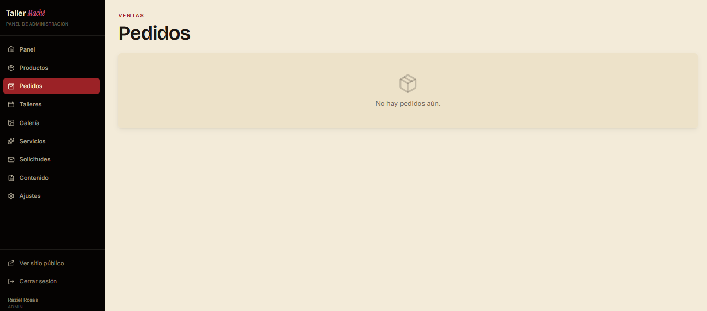

# Taller Maché

**Art workshop booking and catalog with atomic capacity control and an order-request flow.**

**Live site:** [https://taller-mache.pages.dev](https://taller-mache.pages.dev)

---

## The problem

An art workshop (papel maché) was taking bookings over WhatsApp and selling finished pieces over DMs. Seats were limited and often oversold by accident when two people wrote at the same time. There was no way for customers to see available sessions, and no record of who had requested which piece. 

The business needed a public booking page and a product catalog that respected real capacity — without an online payment gateway, because every order gets a human confirmation first.

## The solution

### Public site
- Marketing home with a gallery of finished pieces.

- Workshop calendar with per-session availability.

- Booking flow with atomic capacity control — no overbooking, ever.

- Product catalog with order-request flow (no online payment; owner confirms via WhatsApp).

### Admin panel
- Token-protected dashboard with bookings and order requests at a glance.

- CRUD on workshops, sessions, products, and categories.

- Order request management with status transitions and email triggers.

- Capacity adjustments that stay consistent with the atomic RPCs used by the public booking flow.

---

## Tech stack

- **Frontend:** React + Vite + Tailwind.

- **Backend & Data:** Supabase (Postgres, Auth, Row-Level Security, Edge Functions).

- **Hosting:** Cloudflare Pages.

- **Email:** Resend / Brevo (transactional emails).

- **Scheduling:** pg_cron for scheduled maintenance and keep-alive tasks.

---

## Architecture

1. The browser interacts with a React Single Page Application hosted on **Cloudflare Pages**.

2. API requests route directly to **Supabase**.

3. Data reads are filtered through strict **Row-Level Security (RLS)** policies.

4. Data writes that affect capacity or stock route through **Postgres RPCs** to ensure absolute transactional integrity.

5. Email dispatches are handled by an **Edge Function** so provider credentials never touch the client.

---

## Notable engineering decisions

- **Atomic capacity RPCs.** Booking a seat calls `increment_workshop_capacity`; purchasing a product request calls `decrement_stock`. Both are transactional and reject on overflow — two simultaneous users can never claim the last seat or the last unit.

- **RLS on every table.** Public tables expose only what the public flow needs (available sessions, published products). Admin tables are gated by role and JWT. No write path bypasses RLS.

- **Auth without the auth-bloat.** Admin credentials are hashed with bcrypt and sessions are issued server-side. There is no end-customer login because order requests and bookings do not require an account — the intent is a fast, low-friction public flow.

- **Email deliverability debugging.** Resend's sandbox restriction blocked delivery to arbitrary recipients; diagnosed by tracing the response status through the Edge Function, then migrated the provider integration to Brevo for unrestricted transactional sends.

- **Absolute OG meta tags.** WhatsApp and most chat clients require absolute URLs in `og:` tags to render a link preview. Every public route emits absolute metadata so shared links resolve properly in messaging apps.

- **CSP + HSTS on Cloudflare Pages.** Strict `Content-Security-Policy` and `Strict-Transport-Security` headers applied at the edge, hardening the public surface without adding a backend hop.

- **Scheduled maintenance via pg_cron.** Session expiry and light cleanup run on the database side, so no external worker is needed for routine housekeeping.

---

## Screenshots

> Redaction note: customer names, emails, phone numbers, and order IDs are obscured in published screenshots.

*Caption: Public home — workshop identity and featured pieces.*

*Caption: Gallery of finished papel maché pieces.*

*Caption: Workshop booking with live seat availability.*

*Caption: Product order-request flow — human-confirmed, no online payment.*

*Caption: Admin login (screenshot only — not publicly accessible).*

*Caption: Admin dashboard — bookings and pending requests.*

*Caption: Workshop list with capacity controls.*

*Caption: Session scheduling and availability.*

*Caption: Product catalog with stock levels.*

*Caption: Order request management with status transitions.*

---

## Status

**Live in production**, used by a real business. Booking and catalog flows are stable; maintenance is focused on content and small UX improvements.

### Roadmap / known limitations
- No online payment — by design; the owner confirms each order manually.

- No end-customer login — bookings and requests are anonymous by intent.

- Reporting is operator-facing only; customer-facing order tracking is out of scope.

---

*Source code is private. This folder is a showcase only.*