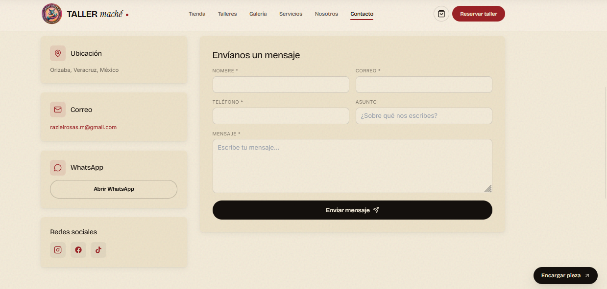
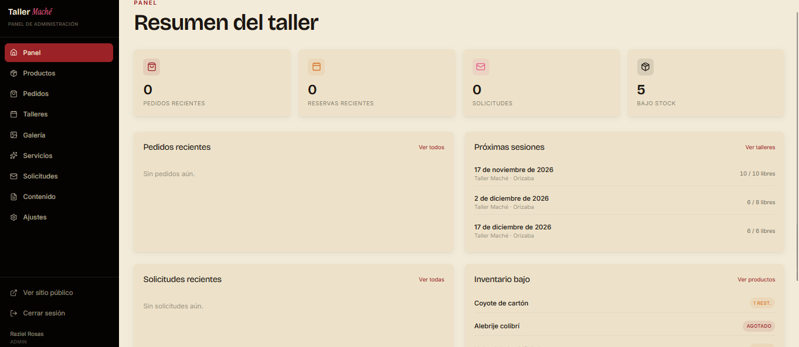

# Taller Maché

### Replacing manual WhatsApp bookings with a structured booking and order system.

Live seat availability · atomic capacity control · secure admin panel · real business running in production — built end-to-end at zero monthly cost.

**[Live site](https://taller-mache.pages.dev)** · **[Screenshots](#screenshots)** · **[Get in touch](#work-with-me)**

---

## The Problem

An art workshop teaching papel maché and cartonería was taking all bookings over WhatsApp and selling handmade pieces through direct messages. This created real problems:

- **Lost bookings.** Bookings were buried in chat threads with no record of who booked what or when.
- **No capacity visibility.** The owner could not see how many seats were left without scrolling chat history. Overbooking happened by accident.
- **No product catalog.** Customers could not browse prices or availability before messaging.
- **Manual follow-up.** Every order required the owner to message each customer by hand.

The business needed a simple digital front door that captured structured bookings and orders — while keeping WhatsApp as the final confirmation step, because that is how the owner and customers already communicate.

## What I Built

A production web application with a public site and a private admin panel that replaced the manual chat workflow end-to-end. Customers can now see available sessions, book a seat, and submit order requests. The owner uses a private dashboard to manage everything in one place.

| Before (The Chat Chaos) | After (The Structured System) |
|---|---|
| Seats tracked from memory | Live seat availability per session, updated on every booking |
| Bookings lost in chat threads | Booking records with customer details, status, and history |
| No product listing | Product catalog with prices, images, and stock levels |
| Manual WhatsApp confirmation for every lead | Automatic email confirmation to customer and owner, then a quick WhatsApp reply |
| No record of what sold | Order and booking history visible in the admin panel |

---

## Engineering Methodology

To make this system reliable for a real business, I had to solve several technical challenges.

**1. Concurrency (Preventing Overbooking)**
- **The Challenge:** Two customers booking the last seat at the same moment could both succeed, overselling the session.
- **The Solution:** Booking and stock changes run through atomic database functions. The database itself rejects the operation if capacity would be exceeded, so two simultaneous users can never claim the last seat or the last unit.

**2. Security (Protecting the Admin Panel)**
- **The Challenge:** The admin panel holds customer names, phone numbers, and order data. It must be impossible for the public to read or write it.
- **The Solution:** Every table has Row Level Security enabled. The public can only read catalog data. All writes require an authenticated staff account. The public key shipped to the browser is safe to expose because authorization lives in the database, not in the client.

**3. Data Integrity (Orders That Never Change)**
- **The Challenge:** If a product price changes later, old orders must not be affected.
- **The Solution:** Each order captures a snapshot of prices at the moment it is placed. Changing the product later does not alter past records.

**4. Email Deliverability (A Real Production Problem)**
- **The Challenge:** The original email provider blocked delivery to customer addresses on its free plan, so confirmation emails bounced.
- **The Solution:** I diagnosed the cause by tracing the error through the server function, then planned the migration to a provider that allows free delivery to any recipient without buying a custom domain. The email logic sits in one isolated function, so switching providers was a small change, not a rewrite.

---

## Zero-Cost Operations

The entire application runs at **$0 per month**, which matters for a small business:

- **Hosting:** Cloudflare Pages, free tier with global CDN and automatic deploys on every push.
- **Database and authentication:** Supabase free tier, kept active by a scheduled daily database ping so the project never pauses from inactivity.
- **Email:** Free transactional email tier, no custom domain required.

This is a deliberate engineering decision: a real business should not need a paid plan just to take bookings online.

---

## Architecture and Tech Stack

The application is built with a lightweight, modern stack:

- **Frontend:** A React Single Page Application hosted on Cloudflare Pages, built with Vite and styled with Tailwind CSS.
- **Backend and Database:** Supabase (Postgres) with Row Level Security on every table.
- **Authentication:** Supabase Auth with securely hashed passwords. No public signup — admin accounts are created manually.
- **Server Logic:** Supabase Edge Functions for email sending, so provider credentials never reach the browser.
- **Scheduling:** A database cron job for automatic maintenance and keep-alive.
- **Security Headers:** Strict Content Security Policy and HTTPS enforcement applied at the edge.

---

## Screenshots

### Public Site
| | |
|---|---|
|    **Home** — workshop identity and featured pieces |    **Gallery** — finished papel maché work |
|    **Booking** — live seat availability |    **Order request** — no online payment |

### Admin Panel
| | |
|---|---|
|    **Dashboard** — bookings and pending requests |    **Workshops** — capacity controls |
|    **Products** — catalog and stock |    **Orders** — status management |

*Customer names, emails, phone numbers, and order IDs are obscured in published screenshots for privacy.*

---

## Status

**Live in production**, used by a real business. Booking and catalog flows are stable. Current work focuses on content updates and small UX improvements.

### Roadmap and known limitations
- **No online payment** — by design; the owner confirms each order personally over WhatsApp.
- **No customer accounts** — bookings and requests are anonymous on purpose, to keep the public flow fast and low-friction.
- **Design refresh** — planned, not urgent.

---

## What This Project Demonstrates

For hiring managers and technical recruiters, this project shows:

- **Full-stack ownership** — database design, security policies, server functions, frontend, and deployment.
- **Production thinking** — the app is deployed, used by a real business, and handles real customer data.
- **Security awareness** — authentication, row-level authorization, secret hygiene, and secure headers.
- **Data correctness** — atomic operations that prevent race conditions, not client-side checks.
- **Cost engineering** — a real business running at zero monthly cost.
- **Real debugging** — diagnosed a non-obvious email delivery problem and chose the correct free alternative.

---

## Work With Me

I built Taller Maché as a real production system for a real business. The admin panel is **not publicly accessible**; access is limited to the owner.

I am currently open to:
- **Junior Developer Roles:** I am eager to bring this problem-solving approach to a full-time engineering team.
- **Freelance and Contract Work:** Building custom booking systems, catalogs, and internal tools for small businesses.
- **Collaborations:** Partnering on lean, operator-first software.

*Note: The source code is private because it is actively used in production. I am happy to do a live code walkthrough during an interview.*

**Reach me:** [Email] · [LinkedIn] · [https://github.com/razielrosasm-cmd]

---

Source code is private. This repository is a showcase of my production work.

