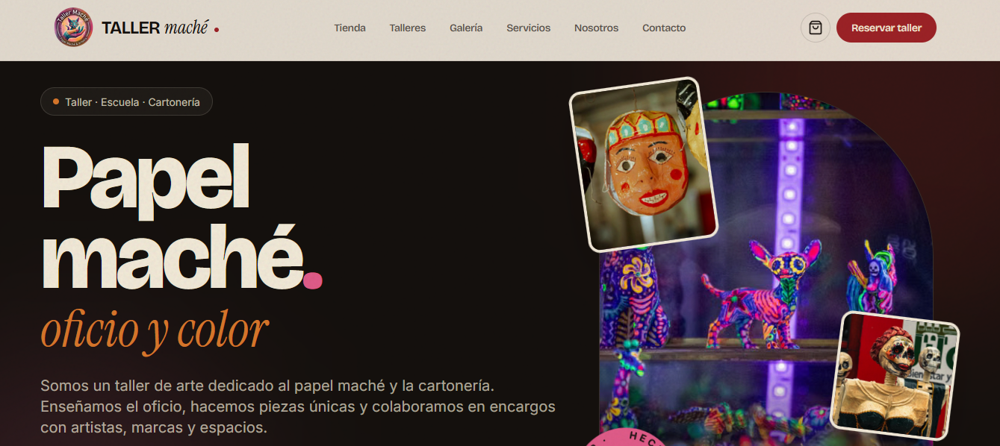
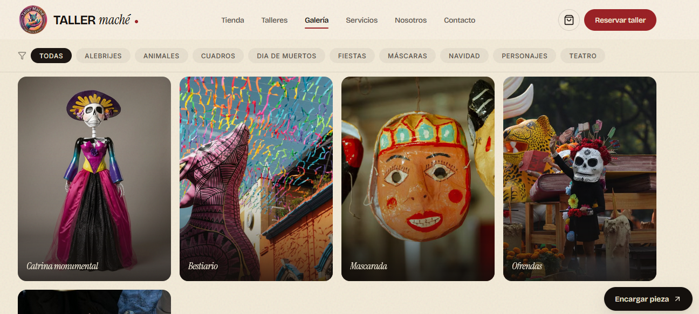
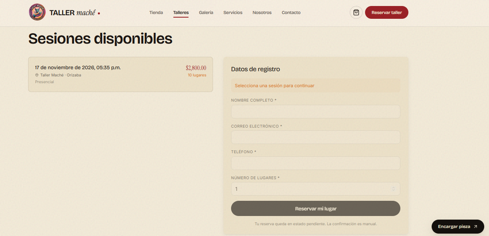
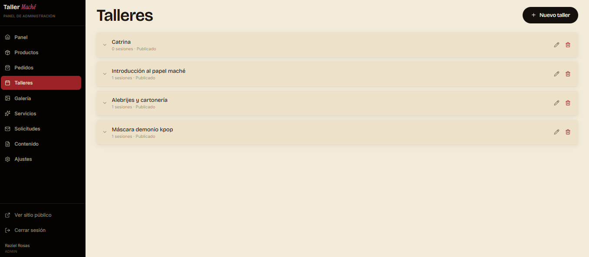
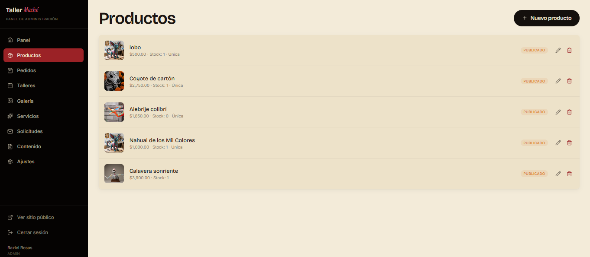
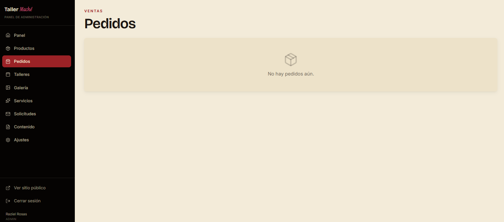

# Taller Maché

### Replacing manual WhatsApp bookings with a structured booking and order system.

Live seat availability · atomic capacity control · secure admin panel · built for a real business, running in production.

**[Live site](https://taller-mache.pages.dev)** · **[Screenshots](#screenshots)** · **[Get in touch](#work-with-me)**

---

## The Problem

An art workshop teaching papel maché and cartonería was taking **all bookings over WhatsApp** and selling handmade pieces through **direct messages**. Seats were limited, and bookings were often lost in chat threads. The owner had **no way to see available seats** and **no record of what had been ordered**.

The business needed a real booking page and catalog that respected real capacity.

## What I Built

A production website and a private admin panel that replaced the chat workflow end-to-end. Customers can now see available sessions, book a seat, and submit order requests. The owner uses a private dashboard to manage bookings and orders in one place.

| Before (The Chat Chaos) | After (The Structured System) |
|---|---|
| Seats tracked from memory | Live seat availability per session, updated on every booking |
| Bookings lost in chat threads | Booking records with customer details, status, and history |
| No product listing | Product catalog with prices, images, and stock levels |
| Manual WhatsApp confirmation for every lead | Automatic email confirmation to customer and owner, then a quick WhatsApp reply |
| No record of what sold | Order and booking history visible in the admin panel |

---

## Engineering Methodology

To make this system reliable for a real business, I had to solve several technical challenges.

**1. Concurrency (Preventing Overbooking)**
- **The Challenge:** Two customers booking the last seat at the same moment could both succeed, overselling the session.
- **The Solution:** Booking and stock changes run through atomic database functions. The database itself rejects the operation if capacity would be exceeded, so two simultaneous users can never claim the last seat or the last unit.

**2. Security (Protecting the Admin Panel)**
- **The Challenge:** The admin panel holds customer names, phone numbers, and order data. It must be impossible for the public to read or write it.
- **The Solution:** Every table has Row Level Security enabled. The public can only read catalog data. All writes require an authenticated staff account. The public key shipped to the browser is safe to expose because authorization lives in the database, not in the client.

**3. Data Integrity (Orders That Never Change)**
- **The Challenge:** If a product price changes later, old orders must not be affected.
- **The Solution:** Each order captures a snapshot of prices at the moment it is placed. Changing the product later does not alter past records.

**4. Email Deliverability (A Real Production Problem)**
- **The Challenge:** The original email provider blocked delivery to customer addresses on its free plan, so confirmation emails bounced.
- **The Solution:** I diagnosed the cause by tracing the error through the server function, then planned the migration to a provider that allows free delivery to any recipient without buying a custom domain. The email logic sits in one isolated function, so switching providers was a small change, not a rewrite.

---

## Business Intelligence

The system does more than take bookings; it gives the owner a clear view of the business:
- **Live capacity view:** seats remaining per session, visible before and after every booking.
- **Order history:** every request captured with customer details and status, so nothing is lost in chat.
- **Catalog control:** products, prices, and stock managed in one place.
- **Cost awareness:** the entire system runs at zero monthly cost, so every peso stays in the business.

---

## Architecture and Tech Stack

The application is built with a lightweight, modern architecture:

- **Frontend:** Cloudflare Pages hosting a responsive Single Page Application built with React, Vite, and Tailwind CSS.
- **Backend and Database:** Supabase (Postgres) with Row Level Security on every table.
- **Authentication:** Supabase Auth with securely hashed passwords. No public signup — admin accounts are created manually.
- **Server Logic:** Supabase Edge Functions for email sending, so provider credentials never reach the browser.
- **Scheduling:** A database cron job for automatic maintenance and keep-alive.
- **Notifications:** Automated confirmation emails to the customer and the owner, with WhatsApp as the final human confirmation step.

---

## Screenshots

### Public Site
| | |
|---|---|
|    **Home** — workshop identity and featured pieces |    **Gallery** — finished papel maché work |
|    **Booking** — live seat availability |    **Order request** — no online payment |

### Admin Panel
| | |
|---|---|
|    **Dashboard** — bookings and pending requests |    **Workshops** — capacity controls |
|    **Products** — catalog and stock |    **Orders** — status management |

*Customer names, emails, phone numbers, and order IDs are obscured in published screenshots for privacy.*

---

## Work With Me

I built Taller Maché as a real production system for a real business. The admin panel is **not publicly reachable**; access is scoped to the owner.

I am currently open to:
- **Junior Developer Roles:** I am eager to bring this problem-solving mindset to a full-time engineering team.
- **Collaborations:** Partnering on lean, operator-first software.
- **Freelance and Contract Work:** Building custom booking systems, catalogs, and internal tools.

*Note: The source code is private as it is actively used in production. I am happy to do a live code walkthrough during an interview.*

**Reach me:** [Email] · [LinkedIn] · [https://github.com/razielrosasm-cmd]

---

Source code is private. This repository is a showcase of my production work.

